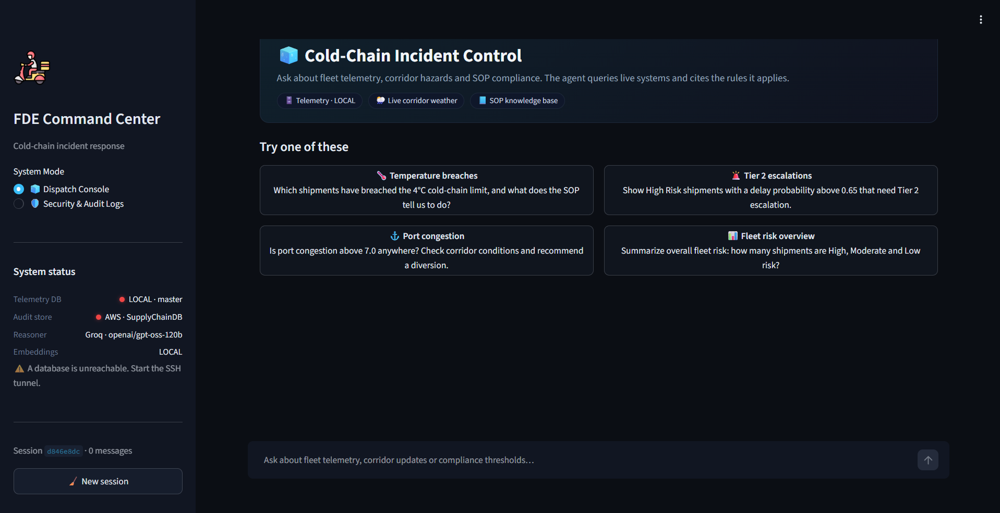
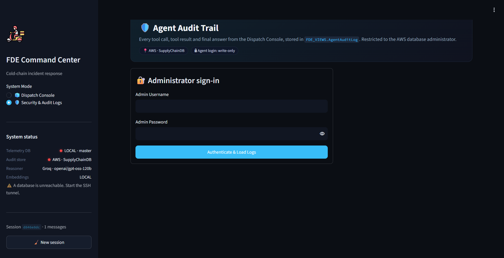
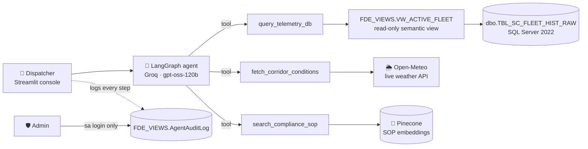
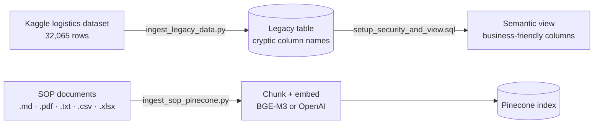

# 🧊 Cold-Chain Logistics AI Assistant

**An AI agent that lets logistics dispatchers ask plain-English questions about their refrigerated fleet and get back an incident report grounded in live telemetry, real-time weather and company SOPs.**

Built end to end as a Forward Deployed Engineering (FDE) project: legacy data ingestion, a locked-down semantic SQL layer, a RAG knowledge base, a tool-calling LangGraph agent, an audited Streamlit console, and deployment to AWS EC2 with GitHub Actions.




---

## The problem

Cold-chain operators sit on years of telemetry in legacy databases with cryptic column names (`IOT_TEMP_VAL_C`, `PRT_CNG_LVL`, `RT_RSK_IDX`). The rules for what to do when something goes wrong live in a separate SOP document. When a reefer truck runs warm or a port backs up, a dispatcher has to:

1. dig through the database for the affected shipments,
2. check the weather and corridor conditions,
3. find the right clause in the SOP, and
4. decide on an action, fast, before the cargo spoils.

## What this project does

A dispatcher types a question such as *"Which shipments have breached the 4°C limit, and what does the SOP tell us to do?"* The agent then:

- **queries the fleet telemetry** through a read-only SQL view,
- **pulls live weather** for the affected GPS coordinates,
- **retrieves the relevant SOP clauses** from a vector database, and
- **writes a structured incident report**: executive summary, telemetry table, and an action plan that cites the SOP rule it applied.

Every tool call, tool result and final answer is **written to an audit log** that only the database administrator can read.

---

## Highlights

| Area | What I built |
|---|---|
| **Agentic AI** | LangGraph state machine with a reasoning node and a tool node, memory per conversation thread, and a swappable LLM backend (Groq, OpenAI or local Ollama) selected from config |
| **RAG pipeline** | Incremental SOP ingestion into Pinecone: header-aware Markdown chunking, PDF/CSV/XLSX parsers, MD5 change detection so only changed files are re-embedded, automatic removal of deleted documents |
| **Data engineering** | Ingests a 32,065-row logistics dataset into a deliberately "legacy-style" SQL Server schema to simulate a real enterprise system; the loader refuses to overwrite existing data and runs as a single transaction |
| **Security by design** | Least-privilege agent login, a semantic view as the only readable object, explicit DENY on the raw table, SELECT-only guard in code, write-only audit log, admin-only log viewer, and SQL Server never exposed to the internet |
| **Cloud & DevOps** | SQL Server 2022 in Docker on AWS EC2, reached only through an SSH tunnel; the app runs as a systemd service and deploys via a GitHub Actions workflow |
| **Product UI** | Streamlit dispatch console with live agent progress, a collapsible trace of every step, a system-status panel, and an audit dashboard with filters and CSV export |

---

## Screenshots

| Dispatch Console | Agent Audit Trail (admin only) |
|---|---|
|  |  |

---

## Architecture



### Data pipelines



### How a question is answered

1. The dispatcher's question and the business system prompt enter the LangGraph state.
2. The reasoning node (LLM) decides which tools to call and with what arguments, for example a T-SQL query against the semantic view.
3. The tool node runs the tools; their results go back to the reasoner.
4. The loop repeats until the model has enough context, then it writes the report in a fixed format: **Executive Summary → Telemetry & Environment Analysis → Required Action Plan with SOP citation**.
5. The UI streams each step live and writes it to the audit log.

---

## Security model

The agent is treated as an **untrusted user**. An LLM can hallucinate a destructive query, so the controls sit in the database rather than in the prompt.

| Layer | Control |
|---|---|
| **Network** | SQL Server binds to `127.0.0.1` inside EC2 and has no public port. Developers connect through an SSH tunnel; the security group only opens SSH to known IPs. |
| **Identity** | The agent connects as `USR_FDE_RO`, a dedicated login with no admin rights. |
| **Data exposure** | The agent can read only `FDE_VIEWS.VW_ACTIVE_FLEET`. The raw table is explicitly `DENY SELECT`, and `INSERT/UPDATE/DELETE/ALTER` are denied on the whole `dbo` schema. |
| **Application** | `query_telemetry_db` rejects anything that isn't a `SELECT` and returns at most 10 rows. |
| **Auditability** | Every agent action is written to `FDE_VIEWS.AgentAuditLog`. The agent login can **insert** rows but never read, change or delete them. |
| **Admin access** | The audit dashboard checks the admin credentials in the app (constant-time comparison), then queries with those credentials, so SQL Server enforces access too. |
| **Secrets** | All credentials live in `.env`, which is gitignored. `.env.example` documents every setting without values. |

---

## Tech stack

| Layer | Technology |
|---|---|
| Agent orchestration | LangGraph, LangChain |
| LLM | Groq (`openai/gpt-oss-120b`) via an OpenAI-compatible API; OpenAI and local Ollama supported |
| Embeddings | `BAAI/bge-m3` (local, 1024-dim) or OpenAI embeddings (1536-dim), each with its own Pinecone index |
| Vector database | Pinecone (serverless) |
| Relational database | Microsoft SQL Server 2022 (Docker), SQLAlchemy, pyodbc / ODBC Driver 18 |
| External data | Open-Meteo weather API |
| UI | Streamlit |
| Infrastructure | AWS EC2 (Ubuntu 24.04), Docker, systemd, SSH tunnelling |
| CI/CD | GitHub Actions (manual deploy workflow over SSH) |

---

## Project structure

```
├── src/
│   ├── orchestrator.py          # LangGraph agent + LLM provider factory
│   ├── agent_tools.py           # SQL, weather and SOP-retrieval tools
│   ├── ui.py                    # Streamlit dispatch console + audit dashboard
│   └── prompts/system_prompt.txt  # Business report format for the agent
├── scripts/
│   ├── ingest_legacy_data.py    # CSV → legacy SQL table (non-destructive)
│   ├── ingest_sop_pinecone.py   # SOP docs → Pinecone (incremental)
│   ├── db_config.py             # Shared local/AWS connection profiles
│   ├── test_db_connection.py    # Read-only connectivity checks
│   ├── setup_security_and_view.sql  # Semantic view + least-privilege login
│   └── create_audit_log.sql     # Audit table + write-only grant
├── data/
│   ├── raw/                     # Source logistics dataset
│   └── policy/                  # Cold-chain incident SOP
├── docs/DATABASE_SETUP.md       # Local + AWS database runbook
├── .github/workflows/deploy.yml # EC2 deployment workflow
└── .env.example                 # All configuration keys, no secrets
```

---

## Getting started (local)

### Prerequisites
- Python 3.12, Docker Desktop, [ODBC Driver 18 for SQL Server](https://learn.microsoft.com/sql/connect/odbc/download-odbc-driver-for-sql-server)
- API keys: Groq and Pinecone (OpenAI is optional)

### 1. Install and configure
```bash
git clone https://github.com/suvammpatra/cold-chain-logistics-FDE-Project.git
cd cold-chain-logistics-FDE-Project
pip install -r requirements.txt
cp .env.example .env        # then fill in passwords and API keys
```

### 2. Start SQL Server
```bash
docker run -d --name legacy-mssql \
  -e "ACCEPT_EULA=Y" -e "MSSQL_SA_PASSWORD=<strong-password>" \
  -p 127.0.0.1:1433:1433 -v legacy_mssql_data:/var/opt/mssql \
  mcr.microsoft.com/mssql/server:2022-latest
```

### 3. Load the data and lock it down
```bash
python scripts/test_db_connection.py --target local        # verify connectivity
python scripts/ingest_legacy_data.py --target local --dry-run
python scripts/ingest_legacy_data.py --target local        # creates the legacy table
```
Then run, as `sa`, in the database that holds the table:
1. `scripts/setup_security_and_view.sql`: semantic view and the agent's read-only login. Set your own password first, and point the `USE` line at your database.
2. `scripts/create_audit_log.sql`: the audit table and the agent's write-only grant.

### 4. Build the SOP knowledge base
```bash
python scripts/ingest_sop_pinecone.py
```

### 5. Run the console
```bash
streamlit run src/ui.py
```

Key settings in `.env`: `DB_TARGET` (`local` | `aws`), `AUDIT_DB_TARGET`, `Agent_llm` (`GROQ` | `OPENAI` | Ollama fallback), `Embeddings_model` (`LOCAL` | `OPENAI`).

---

## Deployment (AWS)

- **Database server:** EC2 (Ubuntu 24.04) running SQL Server 2022 in Docker, published on loopback only, with data on host bind mounts and an `unless-stopped` restart policy.
- **App server:** a separate EC2 instance runs the Streamlit app as a `systemd` service.
- **Access:** developers and tools reach SQL Server through `ssh -N -L 14330:127.0.0.1:1433 <ec2-host>`. Port 1433 is never opened publicly.
- **CI/CD:** the *Enterprise Manual Deploy* GitHub Actions workflow SSHes into the app server, pulls `main` and restarts the service. Host, user and key are stored as GitHub environment secrets.

The full runbook (tunnels, VS Code connection profiles, verification queries, troubleshooting) is in [docs/DATABASE_SETUP.md](docs/DATABASE_SETUP.md).

---

## Engineering decisions & lessons learned

- **Guardrails in the database, not the prompt.** Prompt instructions can be ignored; a `DENY` cannot. The agent's login simply can't see or change the raw table.
- **A "legacy" schema on purpose.** Cryptic column names mirror what FDEs meet at real customers. The semantic view translates them, so the LLM writes simpler, more accurate SQL.
- **Ingestion that can't destroy data.** The loader never uses `replace`, stops if the table already exists, prints exactly which server and database it is about to write to, and wraps the load in one transaction.
- **Separate local and cloud targets.** Local Docker and AWS have separate profiles (`LOCAL_*` / `AWS_*`) and different ports, and the code refuses an AWS profile pointing at the local port, so the two can't be mixed up.
- **Incremental RAG.** File hashes mean re-running ingestion only re-embeds changed SOPs and removes deleted ones from Pinecone, instead of rebuilding the index.
- **Provider-agnostic LLM layer.** Switching between Groq, OpenAI and a local model is a one-line `.env` change. That proved useful for comparing cost, latency and tool-calling quality.
- **Real-world debugging.** For example: on Windows, `localhost` resolves to IPv6 `::1` first, while the Docker port is bound to IPv4 `127.0.0.1`. The resulting "connection refused" errors were fixed by always using explicit `127.0.0.1` targets.

---

## Roadmap

- Enforce read-only access in the SQL tool with a query parser in addition to the prefix check
- Add Microsoft Entra ID / SSO for the admin dashboard instead of SQL credentials
- Evaluation suite (golden questions with expected SQL and SOP citations) to compare LLM backends
- Containerise the Streamlit app and add automated tests to the CI pipeline

---

## Dataset

[Logistics and Supply Chain Dataset](https://www.kaggle.com/datasets/datasetengineer/logistics-and-supply-chain-dataset) (Kaggle): 32,065 hourly records (2021–2024) of GPS position, IoT temperature, port congestion, route risk, delay probability and risk classification. The SOP in `data/policy/` is a fictional internal document written for this project.

---

## Author

**Suvam Patra**: designed, built and deployed this project end to end.

[GitHub](https://github.com/suvammpatra) · [LinkedIn](https://www.linkedin.com/in//suvam-patra-in/)

If you have questions about the architecture or want to talk about FDE / applied-AI roles, feel free to reach out.
